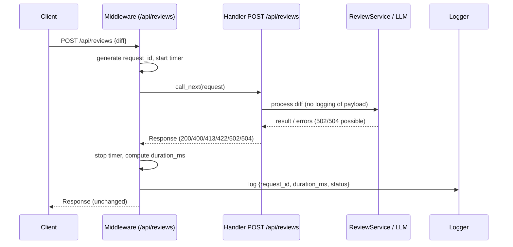

# Design

## Context

See proposal.md - Why. The FastAPI app exposes POST /api/reviews. We must comply with OBS-1 (docs/requirements.md): write exactly one minimal log record per such request and never log diff or model output. Responses and behavior must remain unchanged. Validation outcomes (400/413/422) and dependency outcomes (502/504) must be reflected in logs.

Constraints:
- No additional data in logs beyond request_id, duration_ms, status.
- Apply only to POST /api/reviews; avoid global noise and overhead.
- Work with FastAPI/Starlette exception handling so a single log is produced for all outcomes.

## Goals / Non-Goals

**Goals:**
- One structured log record per POST /api/reviews request with fields: request_id, duration_ms (ms), status (HTTP status code).
- Cover outcomes 200, 400, 413, 422, 502, 504.
- Ensure the log is emitted exactly once per request, even when exceptions are handled by FastAPI.
- Keep implementation minimally invasive and independent from business logic.

**Non-Goals:**
- Do not log request bodies, headers, the diff content, or model/LLM outputs.
- Do not change API response bodies or headers.
- No introduction of external logging frameworks or tracing systems.
- No propagation of request_id to clients unless explicitly required later.

## Decisions

1) Mechanism: ASGI middleware scoped to /api/reviews
- Choice: Implement a FastAPI/Starlette middleware that wraps handling of requests. It will activate only when request.url.path == "/api/reviews" and request.method == "POST".
- Rationale: Middleware centralizes timing and logging, guarantees a single emission point regardless of control flow inside the endpoint or exception handlers, and avoids duplicating logic inside handlers.
- Alternatives considered:
  - Inline logging in the endpoint function: misses validation (422) and early returns; risks duplication; harder to ensure exactly one log line.
  - Dependency or APIRouter event hooks: less direct control over exceptions and final status; still risks duplication or gaps.

2) request_id generation
- Choice: Generate a per-request UUIDv4 in the middleware for /api/reviews.
- Rationale: Ensures presence for all outcomes without depending on clients. Simple and deterministic for tests.
- Alternatives considered: Trusting inbound X-Request-ID (security and trust issues, not required by spec), or deriving from headers; deferred as an open question if needed later.

3) Duration measurement
- Choice: Use time.perf_counter() at entry and exit; compute duration_ms = round((end - start) * 1000).
- Rationale: perf_counter has suitable resolution; converting to ms matches spec wording and tests.
- Alternatives considered: time.time() (lower resolution); monotonic_ns (higher precision but unnecessary).

4) Status determination and single emission
- Choice: Call call_next(request) inside try/finally. When call_next returns a Response, use response.status_code. If an unhandled exception bubbles (should be rare given app design), emit a log with status=500 and re-raise to preserve default handling.
- Rationale: Ensures exactly one log line in both normal and exceptional paths while not altering behavior.
- Alternatives considered: Wrapping exception types individually (more complex and brittle); relying on logging in exception handlers (duplicates and dispersion).

5) Structured logging format and logger
- Choice: Use Python logging with an app-specific logger name (e.g., "observability.requests"). Emit a single INFO log with a minimal JSON object: {"request_id": str, "duration_ms": int, "status": int}.
- Rationale: JSON is easy to assert in tests and integrates well with modern log pipelines. Minimal keys satisfy OBS-1 and the spec delta scenarios.
- Alternatives considered: Plain text messages (harder to parse reliably); external JSON loggers (unnecessary complexity).

6) Path scoping and minimal overhead
- Choice: Perform a quick path/method check to limit the middleware to POST /api/reviews and bypass logging for other routes.
- Rationale: Avoids unnecessary noise and cost for unrelated endpoints.

## Risks / Trade-offs

- Duplicate logs if future code adds additional request logs → Mitigation: Keep logging centralized in middleware and document policy to not add per-endpoint request logs.
- Accidental inclusion of sensitive data → Mitigation: Build the log dict explicitly with only allowed keys; never include request objects or payload-derived fields.
- Incorrect status if exceptions bypass response creation → Mitigation: Fallback to status=500 in the rare case of an unhandled exception; the app is designed to return 502/504 instead.
- Middleware ordering issues → Mitigation: Register middleware once during app setup (app startup), keep it simple and independent of other middleware; rely on FastAPI's standard order.
- Performance overhead → Mitigation: Scope to a single path; use inexpensive operations (uuid4 + perf_counter + one log line).

## Migration Plan

- Implementation steps (align with tasks.md):
  1. Add tests asserting a minimal log entry exists for 200/400/413/422/502/504 and that only the three fields are present (no diff/model text).
  2. Implement a FastAPI middleware that:
     - On POST /api/reviews: generate request_id, start timer, call_next, compute duration_ms, capture status, emit one JSON log with allowed fields.
     - On other routes: pass through without logging.
  3. Ensure exception-handled responses still produce a single log record.
  4. Run sh scripts/check.sh and confirm tests pass.
- Rollback: Remove the middleware registration; no data migration required.
- Deployment: No config changes required; logs go to the existing logger handlers/STDOUT.
 
## Interaction Diagram

## Open Questions

- Should we honor inbound X-Request-ID and propagate it instead of generating our own? Deferrable; not required by specs.
- Should we expose request_id back to clients (e.g., in a header) for support correlation? Out of scope for now.
- Exact log format expectations for CI: JSON is proposed; if CI expects text, we can keep the JSON payload as the message string without changing behavior.
