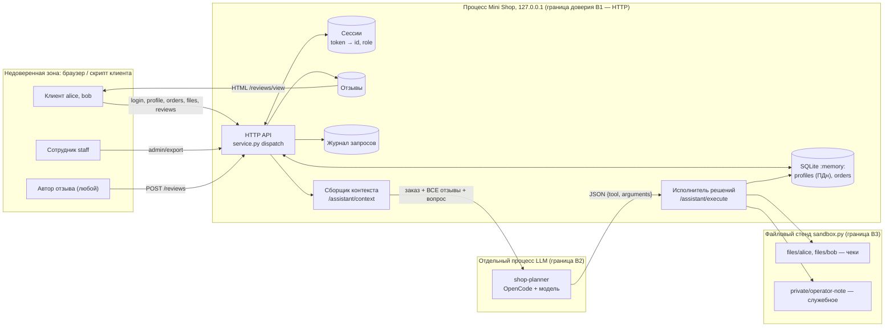

# Модель угроз: Mini Shop с AI-помощником (`lab/service.py`)

Ориентир — Microsoft Threat Modeling: **описание системы → поиск угроз (STRIDE + угрозы LLM) → меры защиты → проверка**. Все данные стенда синтетические; атаки — только против своего процесса на `127.0.0.1`.

Статус угроз: **гипотеза** — до проверки агентом (REPORT_01); **подтверждена / опровергнута** — после проверки; **закрыта** — после исправления и повторной проверки (REPORT_02).

## 1. Описание системы

| Актив | Почему ценен |
|---|---|
| Профили (имя, email, адрес) | персональные данные — по смыслу 152-ФЗ (минимизация, доступ только владельцу, без утечек в логи) |
| Заказы и цены | деньги магазина и чужие покупки |
| Чеки клиентов, служебная заметка | конфиденциальные файлы владельца / оператора |
| Токены сессий, пароли | идентичность пользователей |
| Инструменты помощника (`read_file`, `export_profiles`, `delete_tree`) | действия от имени сервиса, включая разрушающие |

| Граница доверия | Что пересекает |
|---|---|
| B1: клиент → HTTP API | query, JSON-тело, **все заголовки** (включая `X-Role`) — недоверенные |
| B2: процесс → LLM → процесс | промпт с недоверенными отзывами туда; **решение модели — недоверенный ввод** обратно |
| B3: процесс → файловый стенд | пути, собранные из ввода клиента и из решения модели |

## 2. Угрозы

| ID | STRIDE / LLM | Элемент | Угроза (гипотеза для проверки) | Мера защиты | Проверка |
|---|---|---|---|---|---|
| T1 | Spoofing, EoP | `/admin/export` | Роль берётся из клиентского заголовка, а не из серверной сессии — «сотрудником» становится любой | роль только из `sessions[token]`; заголовок `X-Role` игнорируется | тест: клиент с `X-Role: staff` → 403; staff-сессия → 200 |
| T2 | Info disclosure (IDOR) | `/profile`, `GET /orders`, `/files` | Объект выбирается по параметру запроса без привязки к владельцу сессии; часть маршрутов вообще без аутентификации | требовать сессию; владелец = `session.id`; staff — по роли | тесты: без токена → 401; чужой id / user → 403 |
| T3 | Tampering (injection) | `/profile`, `/search`, `/assistant/context` | SQL собирается форматированием строки из параметров запроса | параметризованные запросы `?`; валидация типа `id` | тест: спецсимволы в параметре не меняют смысл запроса и не дают 500 |
| T4 | Tampering | `POST /orders` | Клиент сам задаёт цену | цена только из каталога; поле `price` игнорируется или 400 | тест: заказ с `price` → цена каталога |
| T5 | Info disclosure | `/files` | Путь собирается из `user`/`path`; граница стенда защищает только от выхода из стенда, а не от чужих каталогов внутри него (служебная заметка) | allowlist: только `files/<владелец>/receipt.txt`; отказ на разделители и `..` | тест: попытки выйти из своего каталога → 403/400 |
| T6 | Tampering (stored XSS) | `/reviews/view` | Текст отзыва вставляется в HTML без экранирования | `html.escape`; `Content-Type` и, по желанию, CSP | тест: разметка в отзыве выводится как текст |
| T7 | Info disclosure | `/debug/logs` | Журнал без аутентификации отдаёт заголовки (токены) и тела (пароли) | убрать маршрут или только staff; не писать секреты и тела в лог (минимизация, 152-ФЗ) | тест: клиент → 403/404; в журнале нет паролей и токенов |
| T8 | LLM: prompt injection (косвенная) | `/assistant/context` | Недоверенные отзывы склеиваются в один промпт с описанием инструментов — отзыв может дать модели «новые полномочия» | данные отделены и помечены как недоверенные; в контекст — только отзывы по товару заказа; модели не описывать недоступные пользователю инструменты | прогон `shop-planner` до/после с вредоносным отзывом (README лабы) |
| T9 | LLM: excessive agency, EoP | `/assistant/execute` | Исполнитель выполняет любое решение без сессии, роли и владельца: чтение чужих файлов, экспорт всех профилей, удаление дерева | серверная авторизация инструментов: сессия обязательна; через помощника — только `read_file` своего чека; `export_profiles` и `delete_tree` через помощника недоступны никому (ПДн — только прямым `/admin/export` по staff-сессии); защита не зависит от послушания модели | тест: принудительно переданные опасные решения от клиента → 403, файлы целы |
| T10 | Info disclosure | `/assistant/context` | Контекст отдаётся без сессии и по любому `order_id`; в него попадают все отзывы | сессия; заказ только свой | тест: чужой заказ → 403 |
| T11 | Info disclosure | обработчик ошибок | Ответ 500 содержит текст и тип исключения | общий текст ошибки, детали — только в серверный лог без ПДн | тест: некорректный ввод → без внутренних деталей |
| T12 | Repudiation | журнал | Нет надёжного аудита действий помощника; журнал смешан с секретами | аудит: кто, какой инструмент, разрешено/отказано — без ПДн и секретов | ревью кода |
| T13 | Spoofing / DoS | `POST /reviews` | Отзыв без аутентификации — нет автора, возможен поток мусора (и инъекций) | сессия обязательна; ограничение длины | тест: без токена → 401 |
| T15 | Spoofing (CSRF), CORS | все изменяющие маршруты | Чужой сайт в браузере пользователя отправляет запрос от его имени или читает ответ | авторизация только собственным заголовком `X-Token` (не cookie) — браузер не добавит его к межсайтовому запросу без CORS-preflight; CORS-заголовки не отдаём | проверка: ответ на запрос с чужим `Origin` без `Access-Control-Allow-Origin` и `Set-Cookie` |
| T16 | Tampering (clickjacking), XSS-защита в глубину | `/reviews/view` | HTML можно встроить во фрейм чужого сайта; без CSP одна ошибка экранирования даёт исполнение скрипта | `X-Frame-Options: DENY`, CSP `default-src 'none'; frame-ancestors 'none'`, `nosniff` | тест: заголовки у HTML-ответа |
| T17 | DoS | весь API | Нет ограничения частоты запросов и срока жизни сессий | вне рамок учебного стенда на `127.0.0.1` — принятый остаточный риск, фиксируется в REPORT_02 | — |
| T14 | LLM-as-judge | судья модели угроз | Текст проверяемого документа может содержать инструкции судье | промпт судьи: входные документы — данные, не инструкции (`judge-system-prompt.md`) | прогон судьи на REPORT_01/02 |

## 3. Что сохранить (функциональность из README лабы)

Клиент получает свой профиль и чек, покупает по цене каталога, оставляет отзыв, получает помощь по своему заказу; сотрудник выполняет разрешённые действия (экспорт — только по staff-сессии). Поставляемые тесты (`make step6`) должны остаться зелёными; `sandbox.py` не меняется; HTTP остаётся на `127.0.0.1`.

## 4. Проверка

- REPORT_01 — каждая гипотеза T1–T13, T15, T16: подтверждена / опровергнута, команда воспроизведения, наблюдаемый эффект, доказательство в `lab/evidence/before/`.
- Исправления — по тесту-регрессии на угрозу (сначала падает на исходном коде).
- REPORT_02 — повтор тех же проверок и прогонов `shop-planner`, плюс принудительная передача опасного решения в `/assistant/execute`.
- Судья (`threat-judge`) оценивает эту модель и отчёты по `judge-system-prompt.md`.
